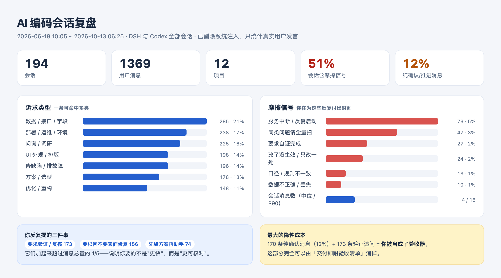

# 会话复盘报告（本机 AI 编码会话统计）

- 生成时间：2026-10-14 09:08
- 数据来源：`~/.dsh/sessions`（DSH 会话，zstd 事件流）与 `~/.codex/sessions`（Codex rollout）
- 口径：已剔除系统注入（workspace instructions、runtime context、后台任务通知、审批代理模板），只统计真实用户发言
- 样本：**194 个会话 / 1369 条真实用户消息 / 12 个项目**

## 一、项目规模与时间跨度

| 项目 | 会话 | 用户消息 | 来源 | 首次 | 最近 |
| --- | ---: | ---: | --- | --- | --- |
| ERP | 113 | 713 | codex | 2026-06-18 10:05 | 2026-07-10 08:45 |
| AI 项目模版 | 10 | 199 | codex | 2026-09-03 01:45 | 2026-09-10 00:59 |
| 物流数据监控（本项目） | 21 | 123 | dsh+codex | 2026-09-14 01:50 | 2026-09-22 02:16 |
| AI 工作台 | 22 | 111 | dsh+codex | 2026-09-11 01:10 | 2026-10-13 06:25 |
| new | 8 | 89 | dsh+codex | 2026-07-15 03:39 | 2026-09-09 09:16 |
| 智能工作台 | 11 | 88 | codex | 2026-07-10 09:07 | 2026-09-03 01:28 |
| MaxKB-2 | 3 | 19 | dsh+codex | 2026-09-10 01:43 | 2026-09-10 08:02 |
| ai-project-template-main | 1 | 16 | codex | 2026-07-14 02:58 | 2026-07-14 08:49 |
| 智能平台 | 2 | 3 | dsh | 2026-09-10 08:03 | 2026-09-10 08:28 |
| iuei-ai-project-template-git-https | 1 | 3 | codex | 2026-07-15 03:35 | 2026-07-15 03:39 |
| onyx-main | 1 | 3 | codex | 2026-09-09 06:54 | 2026-09-09 07:32 |
| shen | 1 | 2 | codex | 2026-07-10 09:06 | 2026-07-10 09:07 |

## 二、诉求类型分布（一条消息可命中多类）

| 类型 | 条数 | 占比 | |
| --- | ---: | ---: | --- |
| 数据 / 接口 / 字段 | 285 | 21% | ████████████████████████████ |
| 部署 / 运维 / 环境 | 238 | 17% | ███████████████████████ |
| 问询 / 调研 | 225 | 16% | ██████████████████████ |
| UI 外观 / 排版 | 198 | 14% | ███████████████████ |
| 修缺陷 / 排故障 | 196 | 14% | ███████████████████ |
| 方案 / 选型 | 178 | 13% | █████████████████ |
| 优化 / 重构 | 148 | 11% | ███████████████ |

## 三、摩擦与返工信号

**98 个会话（51%）**至少出现过一次摩擦信号。

| 摩擦类型 | 条数 | 占比 | |
| --- | ---: | ---: | --- |
| 服务中断 / 反复启动 | 73 | 5% | ████████████████████████████ |
| 同类问题请全量扫 | 47 | 3% | ██████████████████ |
| 要求自证完成 | 27 | 2% | ██████████ |
| 改了没生效 / 只改一处 | 24 | 2% | █████████ |
| 口径 / 规则不一致 | 13 | 1% | █████ |
| 数据不正确 / 丢失 | 10 | 1% | ████ |

## 四、流程偏好（你反复提的要求）

| 要求 | 条数 | 占比 | |
| --- | ---: | ---: | --- |
| 要求验证 / 复核 | 173 | 13% | ████████████████████████████ |
| 要根因不要表面修复 | 156 | 11% | █████████████████████████ |
| 先给方案再动手 | 74 | 5% | ████████████ |
| 禁止臆测 / 只读审查 | 15 | 1% | ██ |
| 中文 / 命名规范 | 14 | 1% | ██ |
| 交接文档 / 换 agent 接手 | 6 | 0% | █ |

## 五、会话长度

- 每会话用户消息数：中位数 **4** 条，P90 **16** 条，最长 **87** 条
- 纯确认/推进消息（≤8 字，如"确认""继续""方案A"）：**170 条（12%）**
| 来源 | 项目 | 消息数 |
| --- | --- | ---: |
| codex | AI 项目模版 | 87 |
| codex | new | 42 |
| codex | ERP | 39 |
| codex | AI 项目模版 | 36 |
| codex | ERP | 35 |

## 六、按天活跃度（消息数）

- 2026-06-18   31  ███████████
- 2026-06-22   56  ████████████████████
- 2026-06-23   48  █████████████████
- 2026-06-24   25  █████████
- 2026-06-25   85  ██████████████████████████████
- 2026-06-26   91  ████████████████████████████████
- 2026-06-27    4  █
- 2026-06-28    3  █
- 2026-06-29   76  ███████████████████████████
- 2026-06-30   67  ████████████████████████
- 2026-07-01   36  █████████████
- 2026-07-02   10  ████
- 2026-07-03   60  █████████████████████
- 2026-07-06   45  ████████████████
- 2026-07-07    6  ██
- 2026-07-08   49  █████████████████
- 2026-07-09    6  ██
- 2026-07-10   46  ████████████████
- 2026-07-13   47  █████████████████
- 2026-07-14   27  ██████████
- 2026-07-15   21  ███████
- 2026-07-16   64  ███████████████████████
- 2026-09-03   59  █████████████████████
- 2026-09-04  113  ████████████████████████████████████████
- 2026-09-09   37  █████████████
- 2026-09-10   23  ████████
- 2026-09-11    8  ███
- 2026-09-14   15  █████
- 2026-09-16    4  █
- 2026-09-17   45  ████████████████
- 2026-09-18   67  ████████████████████████
- 2026-09-20   36  █████████████
- 2026-09-21   33  ████████████
- 2026-09-22   14  █████
- 2026-10-08    6  ██
- 2026-10-09    1  █
- 2026-10-10    1  █
- 2026-10-12    3  █
- 2026-10-13    1  █

## 七、建议（按优先级，每条对应上面的数据）

### P0 · 把「验收」变成交付物的一部分

- 对应数据：纯确认/推进 166 条（13%）+ 验证/复核 117 条（9%）+ 要求自证 27 条 —— **你在被当成验收器**。
- 做法：每份交付附一张「验收清单」，一行一条需求，写清 **在哪验 / 怎么验 / 期望看到什么**；交付时逐条核销，没做到的明说。
- UI 类交付另附：改前改后截图 + 关键量值（不要只写「已对齐」，要写"宽 232px、垂直居中"）。

### P0 · 服务与环境固定化

- 对应数据：服务中断 / 反复启动 73 条，是**最高频**的摩擦。
- 本项目已有 `deploy/com.logistics.monitor.plist` 但未加载；建议落地为开机自启 + 统一 `up / down / status` 三个命令。
- 约定一条硬规则：改了服务端代码必须重启，并贴出启动日志时间戳，否则不算完成。

### P1 · 一处不对，就全量扫同类

- 对应数据：同类问题请全量扫 47 条（「还有没有其他地方有这种问题」）。
- 做法：修复 / 统一 / 重构类需求，交付时附「同类位置清单 + 每处处理结果」，不让用户发现第二处。

### P1 · 业务口径唯一化

- 对应数据：口径 / 规则不一致 36 条。
- 做法：一个业务概念只允许一个定义；它出现在统计、筛选、导出多处时，加一条「卡片值 = 筛选 total」式的断言。
- 本项目实例：「未签收」卡片 15 票 vs 列表 173 票，已修复并加了断言。

### P2 · 「先给方案」做成阈值，而不是每次都问

- 对应数据：先给方案再动手 94 条，但你也会说「给方案即可，不需要你重构」。
- 阈值建议：视觉 / 交互 / 架构 / 数据模型 → 先给 2-3 个方案；纯 bug、文案、样式微调 → 直接做。

### P2 · 交接文档瘦身

- 对应数据：交接类 9 条，且你自己提过「内容过多请简化」。
- 固定四段：当前状态 / 下一步 / 阻塞 / 踩坑；历史交付移入 `docs/交接归档-<月份>.md`，正文只留最近一次。

### P3 · 术语与中文统一

- 对应数据：中文 / 命名规范 35 条。
- 做法：固定术语表（未签收 / 待填写单号 / 运输异常 / 同步异常 / 站点 / 运营…），一次说清，之后不再逐条纠正。

### 关于 skill（承接「最该做哪个 skill」）

- 54% 的会话含摩擦信号，且最高频的三类（服务未生效、只改一处、口径不一致）都指向同一件事：**缺少「交付前自证」的固定动作**。
- 建议把 P0/P1 固化成两处：`~/.dsh/skills/verifying-ui-changes-in-browser/SKILL.md`（跨项目）+ 项目 `AGENTS.md` 的三条硬约束。

## 八、口径与局限

- 分类靠关键词匹配，一条消息可命中多类，比例用于**横向比较**，不等于精确占比。
- 「要求验证 / 复核」含"检查 / 验证 / 测试 / 是否已…"等措辞，与"问询"存在重叠。
- 会话时长、token 成本、返工轮次未纳入：跨会话串联同一需求需要人工判断，当前口径不做推断。
- ERP 项目的会话里相当比例是长任务与后台流程，其消息密度不宜与人工短会话直接类比。
- 只统计用户发言，未统计助手输出与工具调用量。
